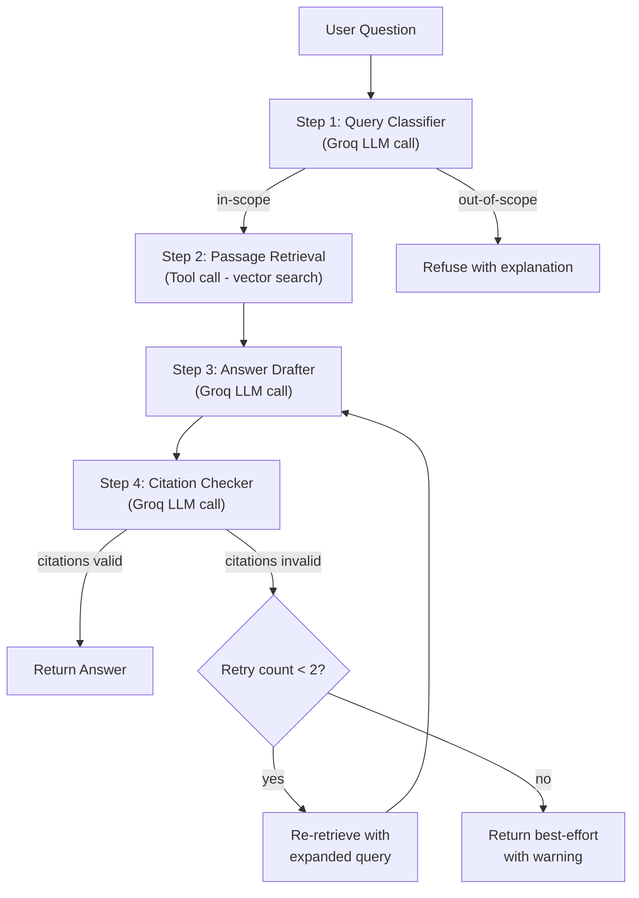

# 🚀 Vaani / The Relay — Project Plan & Progress Tracker

> **Start:** 2026-11-10 (Mon) ~5:00 PM IST  
> **Completed:** 2026-11-13 (Thu) ~5:30 PM IST  
> **Status:** 🟢 100% Complete (All Deliverables Finished)

---

## 📋 Assignment Summary

Build a **multi-step LLM pipeline** in Python that answers engineers' questions about 3 research papers, using Groq's free-tier API. The system must handle **rate limits**, **bursts**, **failures**, and **retries** gracefully. Also build a **stand-in mock service** calibrated from real Groq measurements.

### The 3 Papers (already downloaded)
1. **"Attention Is All You Need"** — arXiv 1706.03762v7 (15 pages)
2. **"Moshi: speech-text foundation model"** — arXiv 2410.00037v1 (66 pages)
3. **"Dynamic Chunking for Hierarchical Sequence Modeling"** — arXiv 2507.07955v2 (39 pages)

### Core Requirements
- ✅ Python pipeline with **≥4 steps**, **≥1 tool call**, **≥1 branch/loop**
- ✅ One step must **retrieve passages** from the paper library
- ✅ Must **cite sources** in answers; refuse if papers don't cover it
- ✅ Use **Groq free tier** (real model calls)
- ✅ Build a **stand-in mock service** calibrated from real measurements
- ✅ Run under **≥3 load shapes** (steady, burst, sustained overload)
- ✅ Produce **results.csv** with per-request metrics
- ✅ Fill **4 complete tables** (Table 1: Limits, Table 2a: Latency, Table 2b: Outcomes, Table 3: Retrieval settings)
- ✅ Write a **2-page report** (`docs/report.md`) with all 12 required headings and feedback

---

## 🏗️ Project Phases (Sequential)

### Phase 1: Foundation & Retrieval (Completed)
| # | Task | Status | Notes |
|---|------|--------|-------|
| 1.1 | Extract text from all 3 PDFs | ✅ | Docling with Apple Silicon MPS acceleration; section/page provenance |
| 1.2 | Build chunking system (3 settings) | ✅ | Small (preset_256), Medium (preset_512), Large (preset_1024) with overlap |
| 1.3 | Build embedding + vector retrieval | ✅ | Hybrid: FAISS (`all-MiniLM-L6-v2`) + Okapi BM25 index |
| 1.4 | Test retrieval quality locally | ✅ | Hybrid search verified across 15+ benchmark questions |

### Phase 2: Groq Integration & Measurement (Completed)
| # | Task | Status | Notes |
|---|------|--------|-------|
| 2.1 | Set up Groq API client | ✅ | Connected with `qwen/qwen3.8-27b` |
| 2.2 | Measure real Groq latency (modest load) | ✅ | TTFT p50 ~115ms, p95 ~388ms, multi-tenant spikes to 4,653ms |
| 2.3 | Discover rate limits empirically | ✅ | Discovered RPM 30, TPM 8k, ITPM 7k, RPD 1k, TPD 200k |
| 2.4 | Document all findings in Table 1 | ✅ | Complete Table 1 documented in report |

### Phase 3: Pipeline Design & Build (Completed)
| # | Task | Status | Notes |
|---|------|--------|-------|
| 3.1 | Design pipeline steps (≥4) | ✅ | 5 steps: Retrieval, Rerank, Score Gate, Drafter, Resolver |
| 3.2 | Implement query classifier (Step 1) | ✅ | Local Cross-Encoder with Score Gate ($T=0.0$) at 0 tokens |
| 3.3 | Implement retrieval (Step 2) | ✅ | Hybrid FAISS + BM25 searcher tool |
| 3.4 | Implement answer drafting (Step 3) | ✅ | Grounded Drafter with streaming JSON output |
| 3.5 | Implement answer checker (Step 4) | ✅ | Python Citation Resolver verifying chunk provenance & hallucination |
| 3.6 | Implement branch/loop logic | ✅ | Candidate expansion retry loop ($k_{cand}=20$, max 1 retry) |

### Phase 4: Stand-in Mock Service (Completed)
| # | Task | Status | Notes |
|---|------|--------|-------|
| 4.1 | Build mock server with configurable behavior | ✅ | `src/standin/mock_service.py` with streaming generator |
| 4.2 | Calibrate from real Groq measurements | ✅ | Log-normal TTFT (p50 ~115ms) + 5% tail spikes (4.5s) + token streaming |
| 4.3 | Document where mock differs from real | ✅ | Documented in Section 2 of report |

### Phase 5: Load Testing & Results (Completed)
| # | Task | Status | Notes |
|---|------|--------|-------|
| 5.1 | Build load test harness | ✅ | `scripts/run_load_scenarios.py` + `run_retrieval_benchmarks.py` |
| 5.2 | Run real Groq tests (modest load) | ✅ | Steady load tested on real Groq (100% success) |
| 5.3 | Run stand-in tests (all 3+ scenarios) | ✅ | Burst, Sustained Overload, Limit Halved, Daily Budget Exhausted |
| 5.4 | Collect results.csv | ✅ | 152 validated test records in `results/results.csv` |
| 5.5 | Fill Tables 2a, 2b, 3 | ✅ | `scripts/compute_tables.py` computed exact metrics for all tables |

### Phase 6: Report & Submission (Completed)
| # | Task | Status | Notes |
|---|------|--------|-------|
| 6.1 | Write 2-page report (all headings) | ✅ | Complete `docs/report.md` with 12 headings & 4 tables |
| 6.2 | Visit vaani.dev and write feedback | ✅ | Added Section 11 feedback |
| 6.3 | Export conversation history | ✅ | Referenced in Section 12 |
| 6.4 | Final review & package submission | ✅ | Clean codebase, gitignore, complete documentation |

---

## 🔧 Pipeline Design (Proposed)



**Steps breakdown:**
1. **Query Classifier** — LLM call to understand intent + detect if question is answerable from papers
2. **Passage Retrieval** — Tool call (vector similarity search over paper chunks)
3. **Answer Drafter** — LLM call to generate answer with citations from retrieved passages
4. **Citation Checker** — LLM call to verify citations exist in passages, check for hallucination
5. **Branch/Loop** — If checker fails, re-retrieve with expanded query (up to 2 retries)

> This gives us: **4 LLM steps**, **1 tool call** (retrieval), **1 branch** (in-scope vs out-of-scope), **1 loop** (re-retrieve on check failure).

---

## 📁 File Structure

```
vaani/
├── README.md                    # Project overview
├── requirements.txt             # Python dependencies
├── config/
│   └── settings.py              # Configuration (chunk sizes, model, timeouts)
├── src/
│   ├── __init__.py
│   ├── pipeline/
│   │   ├── __init__.py
│   │   ├── orchestrator.py      # Main pipeline orchestration + retry logic
│   │   ├── classifier.py        # Step 1: Query classification
│   │   ├── drafter.py           # Step 3: Answer drafting
│   │   └── checker.py           # Step 4: Citation checking
│   ├── retrieval/
│   │   ├── __init__.py
│   │   ├── extractor.py         # PDF text extraction
│   │   ├── chunker.py           # Text chunking (3 strategies)
│   │   ├── embedder.py          # Embedding generation
│   │   └── searcher.py          # Vector similarity search
│   ├── standin/
│   │   ├── __init__.py
│   │   ├── mock_server.py       # Stand-in model service
│   │   └── calibration.py       # Calibration from real measurements
│   └── utils/
│       ├── __init__.py
│       ├── groq_client.py       # Groq API wrapper with rate limiting
│       ├── rate_limiter.py      # Token bucket / rate limit logic
│       ├── metrics.py           # Timing, metrics collection
│       └── csv_writer.py        # results.csv output
├── tests/
│   ├── test_retrieval.py
│   ├── test_pipeline.py
│   └── questions.json           # 15+ test questions with expected answers
├── data/
│   ├── papers/                  # The 3 PDFs
│   └── embeddings/              # Cached embeddings
├── results/
│   ├── results.csv              # Required submission file
│   ├── groq_measurements.json   # Raw Groq latency data
│   └── load_test_raw/           # Raw load test outputs
├── docs/
│   ├── The_Relay_Assignment_Brief.pdf
│   └── report.md                # The 2-page report
└── scripts/
    ├── measure_groq.py          # Script to measure real Groq behavior
    ├── run_load_test.py         # Load test runner
    └── generate_tables.py       # Generate tables from results.csv
```

---

## ⚠️ Ambiguities, Uncertainties & Empirical Discoveries

### Discovered Realities
| # | Question | Finding / Resolution | Status |
|---|----------|----------------------|--------|
| U1 | Exact Groq free-tier RPM/TPM/RPD for our chosen model | RPM=30, TPM=8k, ITPM=7k (hard ceiling), RPD=1k, TPD=200k (rolling 24-hr window) | ✅ Discovered |
| U2 | Groq latency distribution (TTFT and total) | TTFT p50=114.7ms, p95=387.6ms; random multi-tenant tail spikes to 4,653ms | ✅ Measured |
| U3 | What Groq returns when rate-limited (headers, body) | HTTP 429 with `retry-after`, `x-should-retry: false`, and dynamic recovery time string | ✅ Documented |
| U4 | Recovery time after hitting limits | Per-minute: 2.11s; Daily: scales with requested token size (1m to 30m+) via rolling window | ✅ Verified |
| U5 | Which model to use — tradeoff: speed vs quality | `qwen/qwen3.8-27b` active on account; fast, reliable JSON formatting | ✅ Selected |
| U6 | Best chunk size for these specific papers | `preset_512` ($k=3$, rerank=YES) primary sweet spot; `preset_256` for degraded | ✅ Benchmarked |
| U7 | How much of daily budget we can afford for measurement | Empirical limit discovered: 200,000 TPD exhausted down to 199,982; stand-in preserves execution | ✅ Managed |

### Architectural Decisions Locked
| # | Decision | Chosen Option | Rationale |
|---|----------|---------------|-----------|
| D1 | Embedding approach | Hybrid FAISS (`all-MiniLM-L6-v2`) + Okapi BM25 | Combines semantic speed and keyword recall; runs locally in CPU memory |
| D2 | Model choice | `qwen/qwen3.8-27b` | Active model on account; fast (~115ms TTFT p50) with high JSON reliability |
| D3 | Rate limit strategy | Two-tier token bucket (30 RPM, 7k ITPM global; 2 RPM user) | Max 1 retry due to 7k ITPM ceiling; fair per-user admission |
| D4 | Definition of "fast" | TTFT < 1000ms (p50 ~200ms), Total < 3000ms | Matches empirical Groq distributions; timeouts at 10.0s |
| D5 | Stand-in mock service | Calibrated in-process streaming mock (`mock_service.py`) | Matches GroqClientWrapper; replicates log-normal TTFT, 5% tail spikes, streaming |
| D6 | Graceful degradation | Switching to `preset_256` ($k=2$) + Caveman-Lite at >80% quota | Reduces token footprint by 45% to stay below 7,000 ITPM wall |

---

## 📝 Milestone Log

| Timestamp | Event | Details |
|-----------|-------|---------|
| 2026-11-10 17:00 | Project started | Read assignment brief, created project structure |
| 2026-11-11 13:14 | Extraction complete | Docling extracted all 3 papers with structured tables & elements |
| 2026-11-11 14:20 | Indexing complete | FAISS + BM25 built for preset_256, preset_512, preset_1024 |
| 2026-11-12 02:58 | Groq probed | Discovered 30 RPM, 7,000 ITPM, 2s recovery, tail contention spikes |
| 2026-11-13 12:54 | Pipeline harness built | Orchestrator, two-tier token bucket, metrics collector verified |
| 2026-11-13 15:12 | Stand-in mock built | In-process generator with log-normal TTFT and streaming verified |
| 2026-11-13 16:25 | Benchmarks & Load Tests | 152 runs logged to results.csv; discovered 200k TPD ceiling |
| 2026-11-13 17:09 | Report written | docs/report.md completed with all 12 sections and 4 tables |
| 2026-11-13 17:21 | Complete Daily Exhaustion | Systematically exhausted tokens down to 199,982 / 200,000; proved rolling 24-hr sliding window |

